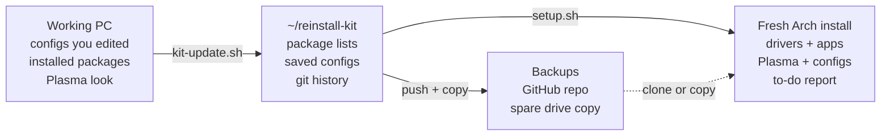

# How the Linux Reinstall Kit Works

Nov 23, 2026 · Vymnkoo

## Overview

The reinstall kit turns a plain `archinstall` system into the full working desktop in one script run: KDE Plasma with the Caelestia Blush look, every program, your own configs, fonts and the fixes found along the way (NVIDIA, Windows clock, Ardour realtime, Spotify key, login-screen blackout). It is at version **3.0.0-alpha** (up to 2.x it installed caelestia + Hyprland instead) and lives in `~/reinstall-kit`, a git repo on GitHub as the public repo `Vymnkoo/reinstall-kit`.

It has two halves that work in opposite directions:

- **`kit-update.sh`** runs on the working PC. It copies the current setup *into* the kit and never changes the PC.
- **`setup.sh`** runs on a fresh install. It reads the kit and builds the PC back up from it.

The kit sits in the middle: kit-update.sh writes to it on the working PC, and setup.sh reads it on the new one after it arrives from GitHub or a backup drive.

A reinstall is three steps: install plain Arch with `archinstall` (about 15 min), run `bash ~/reinstall-kit/setup.sh` (20–60 min, mostly waiting), then reboot and work through the short "still to do by hand" list.

Personal parts (wallpapers, an extra drive's mount line, disk notes, a server-hosting option) are kept in a separate private add-on repo, `reinstall-kit-private`. The kit works without it.

## What's in the kit

Everything the scripts act on is a plain text list or a copied file, so changing what gets installed means editing one line.

| Path | What it holds | Written by | Read by |
| --- | --- | --- | --- |
| `setup.sh` | The installer: menu, 9 steps, report | you | — |
| `kit-update.sh` | Saves the working PC into the kit | you | — |
| `packages/core.txt`, `tools.txt` | Desktop basics (incl. KDE Plasma) and terminal tools, always installed | you | setup.sh |
| `packages/rice.txt` | The Caelestia Blush look: Klassy, Better Blur DX, login theme, cursor; always installed | you | setup.sh |
| `packages/apps.txt`, `gaming.txt`, `creative.txt`, `dev.txt` | One list per menu choice; `flatpak:` lines are Flatpaks | you + kit-update (new apps go to apps.txt) | setup.sh |
| `packages/hw-*.txt`, `cpu-*.txt` | GPU and CPU drivers, picked by detected hardware | you | setup.sh |
| `packages/_not-in-kit.txt` | Installed here but left out on purpose (OBS, from Bazaar) | you | kit-update.sh |
| `packages/_archinstall.txt` | What archinstall already installs, so kit-update doesn't flag it | you | kit-update.sh |
| `configs/files.txt` | Which files in `~` count as "your configs" | you | kit-update.sh |
| `configs/home/` | The saved copies of those files and fonts | kit-update.sh | setup.sh |
| `configs/vscodium-extensions.txt`, `uv-tools.txt` | Extensions and uv tools | kit-update.sh | setup.sh |
| `system/fstab-extra.txt` | Extra drives to mount (an example only, in this repo) | you | setup.sh |
| `system/plasma-rice/` | Login screen theme + colours, login screen on KWin, console cursor (`apply-system.sh`) | you | setup.sh |
| `extras/kwin-rounded-corners/` | Fixed recipe for the rounded-corners KWin effect (the AUR one was broken) | you | setup.sh |
| `extras/zen/user.js` | Zen browser fix for flicker under blur | you | you, by hand |
| `extras/davinci-resolve/` | The bumped Resolve PKGBUILD + `install-resolve.sh` | kit-update.sh | you, by hand |
| `README.md`, `CHANGELOG.md` | The beginner guide and version history | you | you |

Only configs you changed yourself are saved: the Plasma look (colour scheme, Plasma style, Klassy/Darkly, window rules, blur and corner settings in `kwinrc`), the panels, shortcuts, keyboard layouts, mouse, monitor, the login splash, kitty, bash and app settings. The splash's copy of the wallpaper is left out; wallpapers live in the private add-on.

The repo also carries two reading copies: `wiki/index.html`, the kit wiki as one page to open in any browser (offline too), and `docs/how-it-works.md`, this doc.

## How setup.sh works

setup.sh checks the machine, asks what to install, then runs 9 steps and ends with a report. Every command that changes something goes through two wrappers, `run` and `srun` (sudo), so `--dry-run` prints those commands instead of running them. Since 1.2.4-alpha it prints every skipped command, including ones whose output is normally hidden.

**Before the menu** it stops early if it is run with sudo, if the system isn't Arch, or if `archlinux.org` can't be reached. It asks for your password once and keeps sudo alive in the background. It then detects hardware: NVIDIA, AMD or Intel graphics from `lspci`, the CPU vendor from `/proc/cpuinfo`, and Windows from any NTFS partition. Old NVIDIA cards (GTX 9xx/10xx and older) are flagged as too old for `nvidia-open`.

**The menu** is a whiptail checklist: `apps`, `gaming`, `creative`, `dev` are on by default, and `dualboot` is on only when Windows was found. Setting `KIT_CHOICES="apps dev"` skips the menu for testing. After a yes on the summary screen, all output is also written to `~/reinstall-kit-setup_<date>.log`.

**The 9 steps:**

1. **System update** — turns on the multilib repo and pacman colour, then `pacman -Syu` with `base-devel` and `git`.
2. **paru** — builds `paru-bin` from the AUR if it isn't there. This is the one step that aborts the run if it fails.
3. **Drivers** — installs each detected `hw-*` and `cpu-*` list. An old NVIDIA card is skipped and goes on the to-do list.
4. **Programs** — imports Spotify's signing key straight from Spotify, then installs `core`, `rice`, `tools` and each picked group; `dualboot` adds `os-prober`. Each list goes to paru in one call; if that fails it retries one package at a time so one broken package can't block the rest. It also makes `/opt/spotify` writable for spicetify.
5. **The look** — Plasma and the rice packages already came with `core` and `rice` in step 4. This step builds the rounded-corners KWin effect from `extras/kwin-rounded-corners/PKGBUILD`.
6. **Your configs** — copies every file in `configs/home/` into `~`, skipping identical ones and backing up any file it replaces to `~/.reinstall-kit-backups/<date>/`. Plasma's panel is paused while it copies, so it can't overwrite the restored panels on exit. The login splash gets a picture (your wallpaper if it's there, else Plasma's default). It refreshes fonts and enables any restored user service with `WantedBy=default.target` (e.g. `audio-boot-log`).
7. **Extra tools** — uv tools, Flatpaks from Flathub, and for `dev`: Claude Code and the VSCodium extensions. It applies the Spotify theme; if that fails, it goes on the to-do list.
8. **System settings** — enables NetworkManager, bluetooth, sddm and weekly SSD trim; runs `system/plasma-rice/apply-system.sh` as root: the astronaut login theme in blush colours, the login screen moved onto KWin with your monitor + mouse settings (so the screen doesn't black out on login and the mouse feels the same), and `vt.global_cursor_default=0` on the kernel command line (UKI or GRUB) so no blinking `_` shows for a moment at login; adds lines from `system/fstab-extra.txt` to `/etc/fstab` only for drives that exist. `dualboot` turns on os-prober and sets the clock to local time to match Windows. `creative` adds you to the `realtime` group (the Ardour fix).
9. **Boot menu** — rebuilds `/boot/grub/grub.cfg` and warns if Windows isn't in it yet.

**The report** lists problems and the "still to do by hand" items, and is saved to `~/reinstall-kit-report.txt`.

Running it again is safe: installed packages, existing groups, enabled services and identical files are all skipped.

## How kit-update.sh works

kit-update.sh takes a snapshot of the working PC and stores it in the kit; it only ever writes inside the kit folder (and its spare copy). Run `bash ~/reinstall-kit/kit-update.sh` after installing programs or changing settings.

1. **Configs** — copies each path in `configs/files.txt` from `~` into a fresh `configs/home.new/`, then swaps it in for `configs/home/`. Paths that don't exist are skipped with a warning.
2. **Leave out** — removes the splash's copy of the wallpaper and any `*.bak` / `*.save` files from the snapshot.
3. **VSCodium extensions** — `codium --list-extensions` into `vscodium-extensions.txt`.
4. **uv tools** — reads each tool's `uv-receipt.toml` and saves its git URL or name into `uv-tools.txt`.
5. **DaVinci Resolve** — copies the hand-bumped PKGBUILD and its scripts from `~/Projects/aur/davinci-resolve`.
6. **Package check** — compares `pacman -Qqe` and installed Flatpaks against every list in `packages/` (and the private add-on's lists, if it's on the PC). Anything new is appended to `apps.txt` (move it to a better list by hand, or to `_not-in-kit.txt` to leave it out on purpose). Anything in a list but no longer installed is only reported, never deleted.
7. **Save and back up** — commits any changes to git as `kit-update <date>`, pushes to GitHub if there are new commits, and refreshes a spare copy on a second drive when one is mounted and writable.
8. **Private add-on** — if `~/reinstall-kit-private` is on the PC, runs its own `private-update.sh` so its parts are saved too.

A push that fails (offline, or `gh` not logged in) shows a warning but doesn't stop the save; the commit stays local until the next run pushes it.

## Using it

Before wiping anything, run `kit-update.sh` once more so the kit matches the PC.

1. **Install Arch.** Boot the Arch USB, connect (`iwctl` for Wi-Fi), run `archinstall` and follow the checklist in `README.md`: GRUB, zram, your user as superuser, KDE Plasma profile, pipewire, NetworkManager, `git`, multilib.
2. **Disks — the only risky part.** On a dual-boot PC use manual partitioning and touch only the two Linux partitions (fat32 `/boot`, ext4 `/`); the Windows partitions must not be changed. On a Linux-only PC the default layout is fine, but it wipes the disk.
3. **Get the kit.** `git clone https://github.com/Vymnkoo/reinstall-kit ~/reinstall-kit` (no login needed), or copy it from a USB stick or backup drive.
4. **Run it.** `bash ~/reinstall-kit/setup.sh`, type your password, tick groups with Space, start with Enter. If it stops partway (internet, AUR down), run it again.
5. **Reboot and finish.** Work through `~/reinstall-kit-report.txt`. The usual items:
   - DaVinci Resolve: download the Linux zip to `~/Downloads`, then run `extras/davinci-resolve/install-resolve.sh`
   - Ardour: pick the JACK/Pipewire audio system, not ALSA
   - Spotify theme, if it didn't apply: open Spotify, log in, close it, run `spicetify backup apply`
   - Thai font Angsana New: copy `angsa*.ttf` from Windows into `~/.local/share/fonts`, then `fc-cache -f`
   - Zen browser: open it once, then copy `extras/zen/user.js` into its profile folder
   - The private add-on, if you use one: clone it (needs `gh auth login`) and run its `private-setup.sh`

To check what it would do without changing anything, run `bash setup.sh --dry-run`; the log goes to `/tmp` instead of your home folder.

## Limits and known gaps

The kit has never been run on a fresh install. It was only tested with `--dry-run` on the working PC; expect a fix or two on the first real run.

- **First real run:** keep `~/reinstall-kit-setup_<date>.log` and the report. Problems there feed the next version, with a bump and a `CHANGELOG.md` line.
- **Look shows after a reboot:** KWin and the login screen only pick up the restored look after logging in again.
- **Monitor + mouse on the login screen:** copied from your Plasma settings when setup.sh runs. Change them in Plasma later, run `sudo bash system/plasma-rice/apply-system.sh $USER` again.
- **Klassy** comes from the AUR; on the working PC it was installed by hand, so kit-update.sh never reports it as gone.
- **Always by hand:** DaVinci Resolve (needs the zip from Blackmagic), Angsana New (Windows font), and legacy NVIDIA drivers for older cards.
- **New programs all go to `apps.txt`:** kit-update.sh can't tell what a package is for, so move each line to its right group. Otherwise a game left in apps.txt is skipped when you tick gaming but untick apps.
- **Removed programs stay in the lists:** kit-update.sh reports them but never deletes lines.
- **Configs outside `files.txt` aren't saved:** add a line there for anything new you customise.
